# Meeting 1 — Real-Data Baselines

Author: **Mikołaj Zwiefka**

## Question and protocol

Do 55 repeated or transformed minority observations improve Egyptian Mau recognition?
The starter's unchanged `data/split.csv` contains 505 training images (15 Mau,
70 per other breed), 160 validation images (20 per breed), and 240 test images
(30 per breed). Added observations come exclusively from the 15 training Mau photos.
See [protocol.md](protocol.md) for fixed settings and the predeclared decision rule.

## Implementation and checks

`oversample()` shuffles complete rounds of the source list and truncates the last
round. For 55 additions, ten photos are used four times and five three times.
It uses the supplied `random.Random`, leaves the input unchanged, and rejects
invalid budgets or duplicate source names. The source schedule matches the
starter's augmentation schedule for each seed.

`augment()` returns a new PIL image, with horizontal flip (p=0.5), random rotation
within ±10°, and brightness/contrast/saturation jitter of 0.1. No vertical flip,
large crop, or hue shift is added. The variant changes **only rotation to ±25°**.
Both versions are retained behind `--augmentation` for reproducibility.
The starter applies its own crop/flip/colour training transform to **all** methods,
including `real` and `oversample`; our augmentation is an additional transform on
the 55 minority copies, refreshed on every load. Oversampled source pixels are
identical before that common training transform.

Automated tests cover the exact budget, balanced source counts, reproducibility,
input immutability, PIL output shape, changing augmentations, and split disjointness.
The contact sheet in `evidence/augmentation-examples.jpg` shows training photos only.
Visual inspection of those examples confirms that the cats remain recognisable;
the strong variant has more visible black corners and edge cropping. The SHA-256
leakage audit found 905 unique image files and no byte-identical duplicates across
roles (see `evidence/leakage-check.json`). This audit does not detect near-duplicates.

## Validation — measured results, all seeds

| Run | Seed | Egyptian Mau recall | Macro-F1 | Accuracy |
| --- | ---: | ---: | ---: | ---: |
| m1-real | 0 | 0.4500 | 0.8609 | 0.8688 |
| m1-real | 1 | 0.5000 | 0.8570 | 0.8625 |
| m1-real | 2 | 0.4500 | 0.8554 | 0.8625 |
| m1-real | 3 | 0.4000 | 0.8403 | 0.8500 |
| m1-real | 4 | 0.6000 | 0.8715 | 0.8750 |
| **m1-real** | **mean ± SD** | 0.4800 ± 0.0758 | 0.8570 ± 0.0112 | 0.8638 ± 0.0093 |
| m1-oversample | 0 | 0.6500 | 0.8912 | 0.8938 |
| m1-oversample | 1 | 0.6000 | 0.8596 | 0.8625 |
| m1-oversample | 2 | 0.6500 | 0.8730 | 0.8750 |
| m1-oversample | 3 | 0.7500 | 0.8934 | 0.8938 |
| m1-oversample | 4 | 0.7000 | 0.8984 | 0.9000 |
| **m1-oversample** | **mean ± SD** | 0.6700 ± 0.0570 | 0.8831 ± 0.0163 | 0.8850 ± 0.0157 |
| m1-augment | 0 | 0.6000 | 0.8836 | 0.8875 |
| m1-augment | 1 | 0.6000 | 0.8718 | 0.8750 |
| m1-augment | 2 | 0.6500 | 0.8715 | 0.8750 |
| m1-augment | 3 | 0.7500 | 0.9057 | 0.9062 |
| m1-augment | 4 | 0.7500 | 0.8989 | 0.9000 |
| **m1-augment** | **mean ± SD** | 0.6700 ± 0.0758 | 0.8863 ± 0.0156 | 0.8888 ± 0.0143 |
| m1-augment-strong | 0 | 0.6000 | 0.8899 | 0.8938 |
| m1-augment-strong | 1 | 0.6000 | 0.8718 | 0.8750 |
| m1-augment-strong | 2 | 0.6500 | 0.8778 | 0.8812 |
| m1-augment-strong | 3 | 0.7500 | 0.8920 | 0.8938 |
| m1-augment-strong | 4 | 0.8000 | 0.9055 | 0.9062 |
| **m1-augment-strong** | **mean ± SD** | 0.6800 ± 0.0908 | 0.8874 ± 0.0131 | 0.8900 ± 0.0122 |

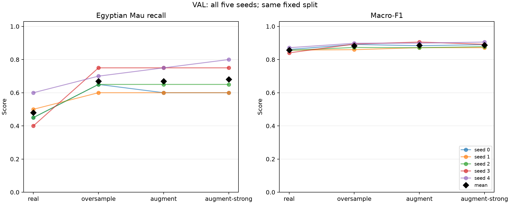

- **m1-oversample** versus real: Mau recall: +19.00 pp mean paired change (SD 10.25 pp; individual changes +20.00, +10.00, +20.00, +35.00, +10.00 pp); macro-F1: +2.61 pp mean paired change (SD 1.85 pp; individual changes +3.03, +0.26, +1.76, +5.30, +2.68 pp).
- **m1-augment** versus real: Mau recall: +19.00 pp mean paired change (SD 9.62 pp; individual changes +15.00, +10.00, +20.00, +35.00, +15.00 pp); macro-F1: +2.93 pp mean paired change (SD 2.08 pp; individual changes +2.27, +1.48, +1.61, +6.53, +2.73 pp).
- **m1-augment-strong** versus real: Mau recall: +20.00 pp mean paired change (SD 9.35 pp; individual changes +15.00, +10.00, +20.00, +35.00, +20.00 pp); macro-F1: +3.04 pp mean paired change (SD 1.39 pp; individual changes +2.90, +1.48, +2.24, +5.17, +3.40 pp).

### Augmentation comparison and decision (written before testing)

Mild mean Mau recall: 0.6700;
strong: 0.6800.
Mild mean macro-F1: 0.8863;
strong: 0.8874.
Increasing the rotation limit therefore changes mean recall by
+1.00 percentage points (paired SD
2.24 pp), and mean macro-F1 by
+0.11 pp. It improves Mau recall in
1/5 seeds, ties in
4/5, and worsens it in
0/5. The rotation range is the only changed
augmentation setting, so this comparison measures its effect within this setup.
The selected augmentation baseline is **m1-augment-strong**, according to the fixed
validation rule: Highest mean validation Mau recall; tie: macro-F1; exact tie: mild.
The decision was recorded at 2026-10-24T08:03:13.965621+00:00 in
`evidence/validation-decision.json`, together with hashes of the validation files.

Five seeds measure training randomness on one fixed split, not uncertainty across
new populations or new data splits. With only 20 validation Mau photos, one photo
changes recall by 5 percentage points. Mean differences must be interpreted
alongside their paired spread; these runs alone do not establish statistical
significance. Stronger rotation may add useful pose variation, but may also
introduce black corners and remove edge content; any observed effect is specific
to this split and training setup.

## Reproduction

```bash
uv sync --locked
uv run synth-data
uv run pytest
uv run synth-train --name m1-real --method real
uv run synth-train --name m1-oversample --method oversample
uv run synth-train --name m1-augment --method augment --augmentation mild
uv run synth-train --name m1-augment-strong --method augment --augmentation strong
uv run python scripts/preview.py
uv run python scripts/report.py validation
uv run synth-test --run m1-real
uv run synth-test --run m1-oversample
uv run synth-test --run m1-augment-strong
uv run python scripts/report.py final
```

The validation report refuses to overwrite an existing decision. To repeat the
whole experiment, use a fresh checkout/output directory rather than mixing runs.
The JSON files contain unrounded values, per-seed predictions, settings, hardware,
and runtime. CSV tables and plots are generated directly from those JSON files.
The local measurements used the installed CUDA 13.0 runtime and main package
versions in `requirements-runtime.txt`, rather than the template's `uv.lock`.
See `protocol.md`. CPU thread limits were `OMP_NUM_THREADS=4` and
`MKL_NUM_THREADS=4` for every training run.

## Test — three chosen baselines

| Run | Seed | Egyptian Mau recall | Macro-F1 | Accuracy |
| --- | ---: | ---: | ---: | ---: |
| m1-real | 0 | 0.4667 | 0.8472 | 0.8542 |
| m1-real | 1 | 0.5333 | 0.8541 | 0.8583 |
| m1-real | 2 | 0.4667 | 0.8602 | 0.8667 |
| m1-real | 3 | 0.4333 | 0.8541 | 0.8625 |
| m1-real | 4 | 0.6333 | 0.8723 | 0.8750 |
| **m1-real** | **mean ± SD** | 0.5067 ± 0.0796 | 0.8576 ± 0.0094 | 0.8633 ± 0.0080 |
| m1-oversample | 0 | 0.7000 | 0.8823 | 0.8833 |
| m1-oversample | 1 | 0.6667 | 0.8734 | 0.8750 |
| m1-oversample | 2 | 0.7000 | 0.8860 | 0.8875 |
| m1-oversample | 3 | 0.7000 | 0.8909 | 0.8917 |
| m1-oversample | 4 | 0.7000 | 0.8698 | 0.8708 |
| **m1-oversample** | **mean ± SD** | 0.6933 ± 0.0149 | 0.8805 ± 0.0088 | 0.8817 ± 0.0086 |
| m1-augment-strong | 0 | 0.6333 | 0.8686 | 0.8708 |
| m1-augment-strong | 1 | 0.6000 | 0.8560 | 0.8583 |
| m1-augment-strong | 2 | 0.7000 | 0.8904 | 0.8917 |
| m1-augment-strong | 3 | 0.6667 | 0.8784 | 0.8792 |
| m1-augment-strong | 4 | 0.6667 | 0.8693 | 0.8708 |
| **m1-augment-strong** | **mean ± SD** | 0.6533 ± 0.0380 | 0.8725 ± 0.0128 | 0.8742 ± 0.0123 |

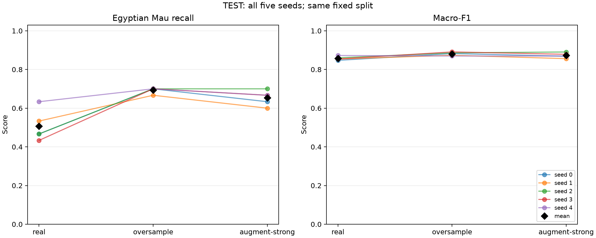

- **m1-oversample** versus real: Mau recall: +18.67 pp mean paired change (SD 8.37 pp; individual changes +23.33, +13.33, +23.33, +26.67, +6.67 pp); macro-F1: +2.29 pp mean paired change (SD 1.59 pp; individual changes +3.50, +1.93, +2.58, +3.67, -0.26 pp).
- **m1-augment-strong** versus real: Mau recall: +14.67 pp mean paired change (SD 9.31 pp; individual changes +16.67, +6.67, +23.33, +23.33, +3.33 pp); macro-F1: +1.49 pp mean paired change (SD 1.46 pp; individual changes +2.14, +0.20, +3.02, +2.42, -0.31 pp).

### What the test results show

Compared with real data only, oversampling raises mean test Mau recall from 0.507 to 0.693 (+18.7 pp; higher in 5/5 seeds) and changes mean macro-F1 by +2.3 pp (lower in 1/5 seeds, by at most 0.3 pp).
Compared with real data only, m1-augment-strong raises mean test Mau recall from 0.507 to 0.653 (+14.7 pp; higher in 5/5 seeds) and changes mean macro-F1 by +1.5 pp (lower in 1/5 seeds, by at most 0.3 pp).

Both classical fixes therefore help Egyptian Mau without harming the other breeds, which agrees with validation. On test, oversampling is ahead of m1-augment-strong by +4.0 pp mean Mau recall (paired SD 2.8 pp; ahead in 4/5 seeds, tied in 1/5). One test Mau photo is 3.3 pp, so this gap is about 1.2 photos per model. On validation the means were 0.670 (oversampling) and 0.680 (m1-augment-strong), so the order between oversampling and augmentation is not established. The difference to real data is larger than the seed spread on both splits. Later methods must beat these three test baselines; the higher one (oversampling, mean Mau recall 0.693) is the strongest classical reference.

Test results are a final measurement; the validation decision remains unchanged.

# Meeting 2 — Text-to-Image Generation

Plan, prompts and decision rule were fixed before generating:
[protocol-m2.md](protocol-m2.md). Every pool was made with `synth-generate`
(110 attempts, seeds 1000–1109) and every run with `synth-train --method synthetic`
(5 seeds; each seed draws a different random 55 images from the pool).
Commands: [scripts/run_m2.py](scripts/run_m2.py).

## Pools

| Pool | Model | Steps | Guidance | Scheduler | Prompts | Usable / attempts | Safety-blocked | s per image | Peak VRAM, MB |
| --- | --- | ---: | ---: | --- | ---: | ---: | ---: | ---: | ---: |
| `m2-base` | sd15 | 30 | 7.5 | dpm | 4 | 109 / 110 | 1 | 4.2 | 3257 |
| `m2-guidance-2` | sd15 | 30 | 2 | dpm | 4 | 109 / 110 | 1 | 4.2 | 3257 |
| `m2-guidance-15` | sd15 | 30 | 15 | dpm | 4 | 110 / 110 | 0 | 4.8 | 3257 |
| `m2-steps-10` | sd15 | 10 | 7.5 | dpm | 4 | 110 / 110 | 0 | 1.6 | 3257 |
| `m2-prompt-simple` | sd15 | 30 | 7.5 | dpm | 1 | 110 / 110 | 0 | 4.2 | 3257 |

Contact sheets (first 24 attempts, failed ones included): [m2-base](pools/m2-base/contact-sheet.jpg), [m2-guidance-2](pools/m2-guidance-2/contact-sheet.jpg), [m2-guidance-15](pools/m2-guidance-15/contact-sheet.jpg), [m2-steps-10](pools/m2-steps-10/contact-sheet.jpg), [m2-prompt-simple](pools/m2-prompt-simple/contact-sheet.jpg).
Same starting noise in every pool (columns = seeds, rows = pools):

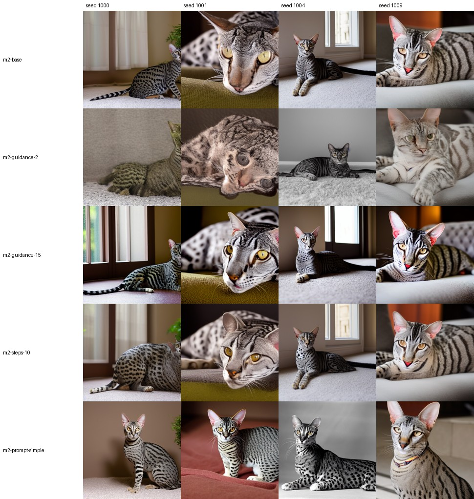

## What the contact sheets show (written before any Meeting 2 classifier result)

Observations from the first 24 attempts of every pool (the contact sheets) and
the same-seed grid above. Counts refer to those 24 images, judged by eye.

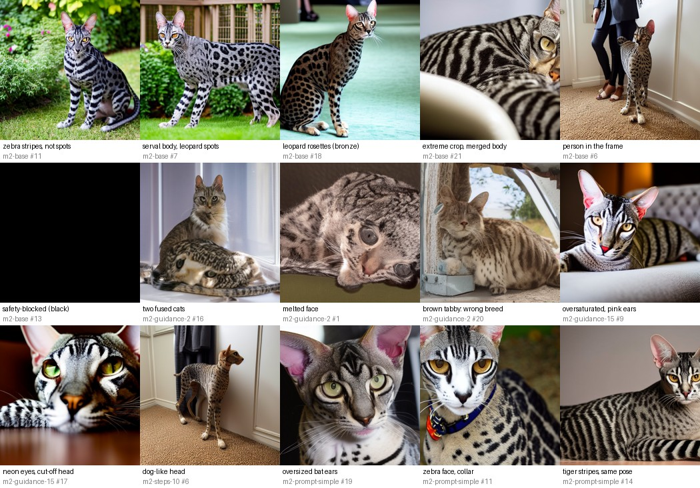

**Failure types found**

- **Wrong coat pattern — stripes instead of spots.** The most frequent failure.
  Real Egyptian Mau have random spots; SD 1.5 often draws mackerel or zebra
  stripes, especially on the body and face (base #9, #11, #15, #17, #20, #21, #23).
  The second base prompt (`close-up … spotted silver tabby coat`) produces it
  almost every time (#1, #5, #9, #17, #21): the word *tabby* pulls towards stripes.
- **Wrong breed — serval/leopard/Bengal look.** Very large ears, long thin legs
  and large solid leopard spots or rosettes (base #2, #7, #10, #18, #22). The
  fourth prompt's *bronze spotted coat* gives Bengal-like leopard rosettes (#18).
  This matters because the real-data classifier already confuses Mau with Bengal.
- **Impossible anatomy.** Merged or fused bodies and melted faces, much more
  frequent at low guidance (guidance 2: #0, #1, #16 two fused cats, #20, #21);
  a dog-like head at 10 steps (#6); stretched, arched bodies at every setting (#22).
- **Framing.** Extreme close-ups that cut the cat off (base #1, #5, #21), which do
  not look like the Oxford-IIIT Pet snapshots; a person's legs in the frame (#6).
- **Painting / over-processed style.** Guidance 15 gives oversaturated, high-
  contrast images with glowing green eyes and bright pink ears (#9, #11, #17);
  they look like illustrations more than photos.
- **Repeated poses and backgrounds.** The single simple prompt gives mostly the
  same sitting pose facing the camera on a plain indoor background, often
  portrait framing, collars, and very large bat-like ears (#5, #19, #21); there are
  no garden or lying scenes.
- **Safety-blocked attempts.** One black image in `m2-base` (#13) and one in
  `m2-guidance-2`; they stay in the manifests as `safety_blocked` and are never
  drawn for training.

**How the settings change the images (same seeds, see the grid)**

- **Guidance 2** follows the prompt loosely: softer, more natural photos with
  realistic lighting, but many cats are ordinary brown or classic tabbies (wrong
  breed) and anatomy fails more often.
- **Guidance 15** keeps the composition of the base image but exaggerates colour,
  contrast and spots; the most "graphic" and least photographic pool.
- **10 steps** is almost identical to the 30-step base for most seeds (the DPM
  solver converges quickly), with slightly softer details and occasional defects.
- **One simple prompt** gives the least diverse pool (poses, backgrounds), but its
  coats are not worse than the base's; the bronze/leopard images disappear.


## Validation — every seed

| Run | Seed | Egyptian Mau recall | Macro-F1 | Accuracy |
| --- | ---: | ---: | ---: | ---: |
| m2-base | 0 | 0.8000 | 0.9180 | 0.9187 |
| m2-base | 1 | 0.8000 | 0.9065 | 0.9062 |
| m2-base | 2 | 0.7500 | 0.8933 | 0.8938 |
| m2-base | 3 | 0.9000 | 0.9068 | 0.9062 |
| m2-base | 4 | 0.8000 | 0.9126 | 0.9125 |
| **m2-base** | **mean ± SD** | 0.8100 ± 0.0548 | 0.9074 ± 0.0092 | 0.9075 ± 0.0093 |
| m2-guidance-2 | 0 | 0.8500 | 0.9187 | 0.9187 |
| m2-guidance-2 | 1 | 0.7500 | 0.8936 | 0.8938 |
| m2-guidance-2 | 2 | 0.8000 | 0.9115 | 0.9125 |
| m2-guidance-2 | 3 | 0.8500 | 0.8995 | 0.9000 |
| m2-guidance-2 | 4 | 0.8000 | 0.9053 | 0.9062 |
| **m2-guidance-2** | **mean ± SD** | 0.8100 ± 0.0418 | 0.9057 ± 0.0098 | 0.9062 ± 0.0099 |
| m2-guidance-15 | 0 | 0.7500 | 0.9049 | 0.9062 |
| m2-guidance-15 | 1 | 0.7500 | 0.8878 | 0.8875 |
| m2-guidance-15 | 2 | 0.7000 | 0.8990 | 0.9000 |
| m2-guidance-15 | 3 | 0.8000 | 0.9003 | 0.9000 |
| m2-guidance-15 | 4 | 0.8000 | 0.9126 | 0.9125 |
| **m2-guidance-15** | **mean ± SD** | 0.7600 ± 0.0418 | 0.9009 ± 0.0091 | 0.9012 ± 0.0093 |
| m2-steps-10 | 0 | 0.8000 | 0.9182 | 0.9187 |
| m2-steps-10 | 1 | 0.8000 | 0.9000 | 0.9000 |
| m2-steps-10 | 2 | 0.8000 | 0.9057 | 0.9062 |
| m2-steps-10 | 3 | 0.8500 | 0.9005 | 0.9000 |
| m2-steps-10 | 4 | 0.8000 | 0.9126 | 0.9125 |
| **m2-steps-10** | **mean ± SD** | 0.8100 ± 0.0224 | 0.9074 ± 0.0079 | 0.9075 ± 0.0081 |
| m2-prompt-simple | 0 | 0.7500 | 0.9175 | 0.9187 |
| m2-prompt-simple | 1 | 0.7500 | 0.8933 | 0.8938 |
| m2-prompt-simple | 2 | 0.7500 | 0.8933 | 0.8938 |
| m2-prompt-simple | 3 | 0.8500 | 0.9005 | 0.9000 |
| m2-prompt-simple | 4 | 0.8000 | 0.9246 | 0.9250 |
| **m2-prompt-simple** | **mean ± SD** | 0.7800 ± 0.0447 | 0.9058 ± 0.0144 | 0.9062 ± 0.0147 |

Meeting 1 baselines on the same validation photos, for reference:

| Run | Seed | Egyptian Mau recall | Macro-F1 | Accuracy |
| --- | ---: | ---: | ---: | ---: |
| m1-real | 0 | 0.4500 | 0.8609 | 0.8688 |
| m1-real | 1 | 0.5000 | 0.8570 | 0.8625 |
| m1-real | 2 | 0.4500 | 0.8554 | 0.8625 |
| m1-real | 3 | 0.4000 | 0.8403 | 0.8500 |
| m1-real | 4 | 0.6000 | 0.8715 | 0.8750 |
| **m1-real** | **mean ± SD** | 0.4800 ± 0.0758 | 0.8570 ± 0.0112 | 0.8638 ± 0.0093 |
| m1-oversample | 0 | 0.6500 | 0.8912 | 0.8938 |
| m1-oversample | 1 | 0.6000 | 0.8596 | 0.8625 |
| m1-oversample | 2 | 0.6500 | 0.8730 | 0.8750 |
| m1-oversample | 3 | 0.7500 | 0.8934 | 0.8938 |
| m1-oversample | 4 | 0.7000 | 0.8984 | 0.9000 |
| **m1-oversample** | **mean ± SD** | 0.6700 ± 0.0570 | 0.8831 ± 0.0163 | 0.8850 ± 0.0157 |
| m1-augment-strong | 0 | 0.6000 | 0.8899 | 0.8938 |
| m1-augment-strong | 1 | 0.6000 | 0.8718 | 0.8750 |
| m1-augment-strong | 2 | 0.6500 | 0.8778 | 0.8812 |
| m1-augment-strong | 3 | 0.7500 | 0.8920 | 0.8938 |
| m1-augment-strong | 4 | 0.8000 | 0.9055 | 0.9062 |
| **m1-augment-strong** | **mean ± SD** | 0.6800 ± 0.0908 | 0.8874 ± 0.0131 | 0.8900 ± 0.0122 |

### Summary

| Run | Mau recall (mean ± SD) | Macro-F1 (mean ± SD) | Δ Mau recall vs m2-base, pp (paired SD; seeds +/=/−) | Δ macro-F1 vs m2-base, pp | Mau→Bengal per model | Other breeds→Mau per model |
| --- | ---: | ---: | ---: | ---: | ---: | ---: |
| m1-real | 0.480 ± 0.076 | 0.857 ± 0.011 | – | – | 5.2 | 0.2 |
| m1-oversample | 0.670 ± 0.057 | 0.883 ± 0.016 | – | – | 2.4 | 1.2 |
| m1-augment-strong | 0.680 ± 0.091 | 0.887 ± 0.013 | – | – | 2.6 | 2.0 |
| m2-base | 0.810 ± 0.055 | 0.907 ± 0.009 | – | – | 1.8 | 0.6 |
| m2-guidance-2 | 0.810 ± 0.042 | 0.906 ± 0.010 | -0.0 (5.0; 2/1/2) | -0.17 | 2.6 | 1.6 |
| m2-guidance-15 | 0.760 ± 0.042 | 0.901 ± 0.009 | -5.0 (3.5; 0/1/4) | -0.65 | 2.0 | 0.4 |
| m2-steps-10 | 0.810 ± 0.022 | 0.907 ± 0.008 | +0.0 (3.5; 1/3/1) | -0.01 | 2.0 | 0.8 |
| m2-prompt-simple | 0.780 ± 0.045 | 0.906 ± 0.014 | -3.0 (2.7; 0/2/3) | -0.16 | 2.0 | 0.8 |

"Mau→Bengal" is the mean number of the 20 validation Egyptian Mau photos that a
model calls Bengal; "other breeds→Mau" is the mean number of the 140 other photos
it calls Egyptian Mau (the price of a higher Mau recall).

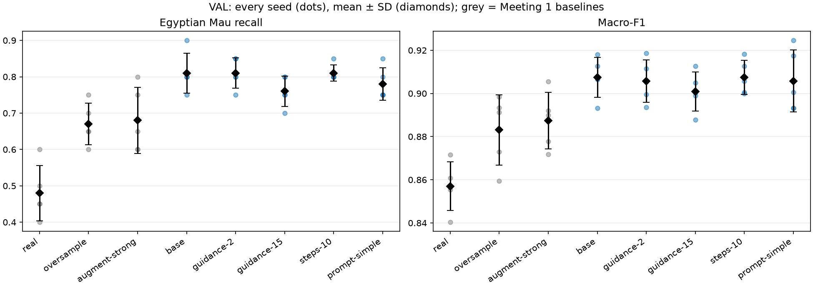

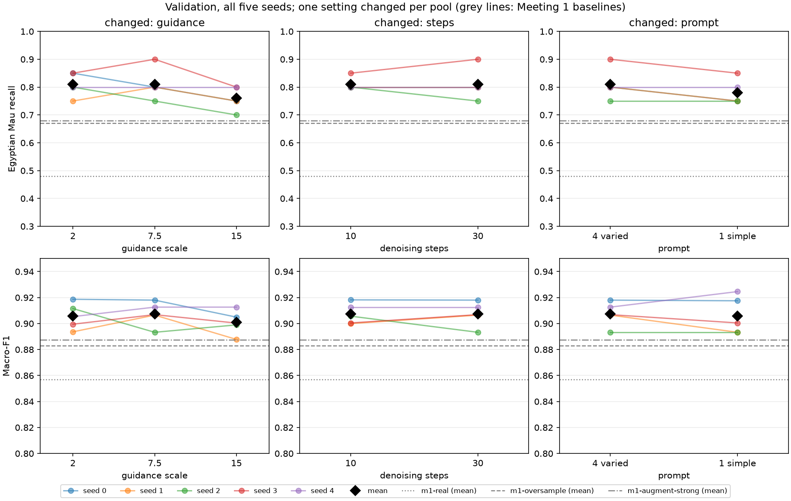

### What the validation results show (written before testing)

- **Every text-to-image pool beats every Meeting 1 baseline on validation.**
  Mean Egyptian Mau recall is 0.76–0.81 for the five pools against 0.67
  (oversampling) and 0.68 (augment-strong), and mean macro-F1 rises too
  (0.901–0.907 against 0.883–0.887), so the gain is not paid for by the other
  breeds. The main mechanism is visible in the confusion counts: real-data models
  call on average 5.2 of the 20 validation Mau photos *Bengal*; with `m2-base`
  this drops to 1.8, while only 0.6 of the 140 other photos per model are wrongly
  called Mau. Fifty-five new, different-looking spotted cats teach the boundary
  between Mau and Bengal better than 55 copies of the same 15 photos.
- **Guidance 15 is the only clearly worse setting:** −5.0 pp Mau recall against
  the base (lower in 4 of 5 seeds, never higher) and −0.65 pp macro-F1. This
  matches the contact sheets: oversaturated, high-contrast, illustration-like
  images are further from the real photos.
- **One simple prompt is slightly worse:** −3.0 pp (lower in 3 seeds, tied in 2).
  Its images have plausible coats but repeat the same pose and background, so
  the 55 drawn images add less variety.
- **Guidance 2 ties with the base on mean Mau recall** (2 seeds higher, 2 lower),
  but its models also call more other cats Mau (1.6 vs 0.6 per model) and confuse
  Mau with Bengal more often (2.6 vs 1.8). The contact sheet shows why it is not
  more useful despite looking more natural: it contains more wrong-breed brown
  tabbies and fused or melted anatomy.
- **10 steps gives the same result as 30 steps** (mean 0.81, three seeds tied).
  With the DPM solver the 10-step images are nearly identical to the 30-step
  ones for the same seed (see the grid), so this is expected; 10 steps would be
  a 3× cheaper way to make the same pool.
- **The differences between pools are small compared with their spread.**
  Apart from guidance 15, every difference to the base is within one or two
  validation photos (5 pp each) and within the paired seed SD (2.7–5.0 pp).
  The large, consistent effect is synthetic data versus the classical baselines,
  not one generation setting versus another.

**Choice.** By the fixed rule the base pool `m2-base` is taken forward: it shares
the highest mean Mau recall (0.81) with guidance 2 and 10 steps; the macro-F1
tie-break differs by only 0.01 pp from 10 steps, and the final tie-break prefers
the base. The contact sheets support the choice over guidance 2 (fewer anatomy
failures, fewer wrong-breed cats, fewer false Mau predictions). Its known flaws
remain: many striped coats (especially from the "close-up … tabby" prompt) and
some serval/leopard-like cats.


### Pool taken forward (written before testing)

By the fixed rule (Highest mean validation Mau recall; tie: macro-F1; then m2-base.) the pool taken forward is
**m2-base**. The decision was recorded at
2026-11-07T08:26:07.472298+00:00 in `evidence/m2-decision.json` together with hashes of
every Meeting 2 validation file.

## Test — chosen run against the Meeting 1 baselines

| Run | Seed | Egyptian Mau recall | Macro-F1 | Accuracy |
| --- | ---: | ---: | ---: | ---: |
| m1-real | 0 | 0.4667 | 0.8472 | 0.8542 |
| m1-real | 1 | 0.5333 | 0.8541 | 0.8583 |
| m1-real | 2 | 0.4667 | 0.8602 | 0.8667 |
| m1-real | 3 | 0.4333 | 0.8541 | 0.8625 |
| m1-real | 4 | 0.6333 | 0.8723 | 0.8750 |
| **m1-real** | **mean ± SD** | 0.5067 ± 0.0796 | 0.8576 ± 0.0094 | 0.8633 ± 0.0080 |
| m1-oversample | 0 | 0.7000 | 0.8823 | 0.8833 |
| m1-oversample | 1 | 0.6667 | 0.8734 | 0.8750 |
| m1-oversample | 2 | 0.7000 | 0.8860 | 0.8875 |
| m1-oversample | 3 | 0.7000 | 0.8909 | 0.8917 |
| m1-oversample | 4 | 0.7000 | 0.8698 | 0.8708 |
| **m1-oversample** | **mean ± SD** | 0.6933 ± 0.0149 | 0.8805 ± 0.0088 | 0.8817 ± 0.0086 |
| m1-augment-strong | 0 | 0.6333 | 0.8686 | 0.8708 |
| m1-augment-strong | 1 | 0.6000 | 0.8560 | 0.8583 |
| m1-augment-strong | 2 | 0.7000 | 0.8904 | 0.8917 |
| m1-augment-strong | 3 | 0.6667 | 0.8784 | 0.8792 |
| m1-augment-strong | 4 | 0.6667 | 0.8693 | 0.8708 |
| **m1-augment-strong** | **mean ± SD** | 0.6533 ± 0.0380 | 0.8725 ± 0.0128 | 0.8742 ± 0.0123 |
| m2-base | 0 | 0.7333 | 0.9033 | 0.9042 |
| m2-base | 1 | 0.8000 | 0.8924 | 0.8917 |
| m2-base | 2 | 0.7333 | 0.8914 | 0.8917 |
| m2-base | 3 | 0.7333 | 0.8961 | 0.8958 |
| m2-base | 4 | 0.7333 | 0.8828 | 0.8833 |
| **m2-base** | **mean ± SD** | 0.7467 ± 0.0298 | 0.8932 ± 0.0074 | 0.8933 ± 0.0076 |

| Run | Mau recall (mean ± SD) | Macro-F1 (mean ± SD) | Mau→Bengal per model | Other breeds→Mau per model |
| --- | ---: | ---: | ---: | ---: |
| m1-real | 0.507 ± 0.080 | 0.858 ± 0.009 | 9.0 | 0.0 |
| m1-oversample | 0.693 ± 0.015 | 0.880 ± 0.009 | 4.2 | 0.4 |
| m1-augment-strong | 0.653 ± 0.038 | 0.873 ± 0.013 | 4.2 | 0.0 |
| m2-base | 0.747 ± 0.030 | 0.893 ± 0.007 | 4.4 | 0.4 |

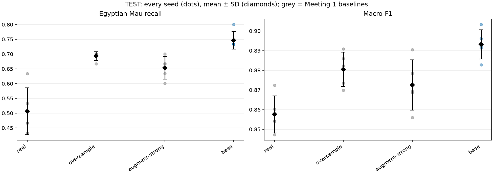

Paired by training seed (one test Mau photo = 3.3 pp):

- **m2-base** versus **m1-real**: Mau recall +24.0 pp (paired SD 8.0; higher/equal/lower in 5/0/0 seeds); macro-F1 +3.56 pp (lower in 0/5 seeds).
- **m2-base** versus **m1-oversample**: Mau recall +5.3 pp (paired SD 4.5; higher/equal/lower in 5/0/0 seeds); macro-F1 +1.27 pp (lower in 0/5 seeds).
- **m2-base** versus **m1-augment-strong**: Mau recall +9.3 pp (paired SD 6.4; higher/equal/lower in 5/0/0 seeds); macro-F1 +2.07 pp (lower in 0/5 seeds).

### What the test results show

- **The chosen text-to-image run beats all three Meeting 1 baselines on test, in
  every seed.** Mean test Mau recall is 0.747 against 0.693 for oversampling (the
  strongest baseline), 0.653 for augment-strong and 0.507 for real data only;
  macro-F1 is also higher (0.893 against 0.873–0.881), so the other breeds are not
  harmed. Against oversampling the gain is +5.3 pp, i.e. about 1.6 of the 30 test
  Mau photos per model, higher in 5/5 seeds.
- **The gain is smaller than on validation** (+14 pp over oversampling there).
  Part of this is expected: `m2-base` was chosen as the best of five pools on only
  20 validation Mau photos, so its validation score is optimistic. The test value
  is the number to carry into Meeting 3.
- **The mechanism differs from validation.** On validation the synthetic pool
  mainly reduced Mau→Bengal confusions. On test, Mau→Bengal stays at about 4 of 30
  photos per model for every method except real data (9.0). The extra gain of
  `m2-base` comes from fewer Mau photos called **Russian Blue** (2.0 per model,
  against 3.6 for oversampling and 4.4 for augment-strong), plausibly because the
  pool adds many silver-grey cats in new poses and lighting. The Mau/Bengal
  boundary is still the main remaining error. This matches the most common failure
  in the pool: striped or leopard-spotted coats do not teach what separates a Mau
  from a Bengal.

Mean number of the 30 test Mau photos per model predicted as each other breed:

| Run | Bengal | Russian Blue | Abyssinian | Siamese |
| --- | ---: | ---: | ---: | ---: |
| m1-real | 9.0 | 5.0 | 0.8 | 0.0 |
| m1-oversample | 4.2 | 3.6 | 1.2 | 0.2 |
| m1-augment-strong | 4.2 | 4.4 | 1.6 | 0.2 |
| m2-base | 4.4 | 2.0 | 1.2 | 0.0 |

**Result carried into Meeting 3:** `m2-base` (SD 1.5, 30 steps, guidance 7.5,
DPM, four varied prompts) — test Mau recall 0.747 ± 0.030, macro-F1 0.893 ± 0.007.

Test results are a final measurement; the validation decision remains unchanged.

# Meeting 3 — Generating from Training Photos

Plan, prompt and decision rule were fixed before generating:
[protocol-m3.md](protocol-m3.md). Commands: [scripts/run_m3.py](scripts/run_m3.py).
All pools use the four `m2-base` prompts and only the 15 Egyptian Mau
**training** photos as sources; image *i* of every pool starts from the same
photo (*i* mod 15) and the same seed, so pools are directly comparable.

## Pools

| Pool | Mode | Strength / scale | Effective steps | Usable / attempts | Safety-blocked | s per image | Similarity to source | Similarity to nearest training photo | Pixel difference to source | Within-pool similarity |
| --- | --- | ---: | ---: | ---: | ---: | ---: | ---: | ---: | ---: | ---: |
| `m2-base` | t2i | – | 30 | 109 / 110 | 1 | 4.2 | – | 0.493 | – | 0.522 |
| `m3-strength-0.3` | img2img | 0.3 | 9 | 110 / 110 | 0 | 1.5 | 0.863 | 0.863 | 0.041 | 0.548 |
| `m3-strength-0.5` | img2img | 0.5 | 15 | 109 / 110 | 1 | 2.3 | 0.741 | 0.746 | 0.064 | 0.554 |
| `m3-strength-0.7` | img2img | 0.7 | 21 | 110 / 110 | 0 | 3.1 | 0.588 | 0.619 | 0.104 | 0.542 |
| `m3-strength-0.9` | img2img | 0.9 | 27 | 110 / 110 | 0 | 4.0 | 0.472 | 0.546 | 0.171 | 0.513 |
| `m3-ip-0.3` | ip-adapter | 0.3 | 30 | 110 / 110 | 0 | 4.3 | 0.495 | 0.563 | 0.291 | 0.567 |
| `m3-ip-0.5` | ip-adapter | 0.5 | 30 | 110 / 110 | 0 | 4.3 | 0.546 | 0.594 | 0.285 | 0.578 |
| `m3-ip-0.7` | ip-adapter | 0.7 | 30 | 108 / 110 | 2 | 4.4 | 0.554 | 0.594 | 0.271 | 0.546 |
| `m3-ip-1.0` | ip-adapter | 1.0 | 30 | 106 / 110 | 4 | 4.4 | 0.542 | 0.578 | 0.259 | 0.520 |

Similarities are cosine similarities of ImageNet EfficientNet-B0 features
(1 = identical); pixel difference is the mean absolute difference at 128×128;
within-pool similarity is the mean similarity between two images of the same
pool (lower = more diverse). For reference, a real training photo has similarity
0.672 to its nearest *other* real training photo, and
two of the 15 training photos have mean similarity
0.538.
Contact sheets (source photo next to each of the first 24 images):
[m3-strength-0.3](pools/m3-strength-0.3/contact-sheet.jpg), [m3-strength-0.5](pools/m3-strength-0.5/contact-sheet.jpg), [m3-strength-0.7](pools/m3-strength-0.7/contact-sheet.jpg), [m3-strength-0.9](pools/m3-strength-0.9/contact-sheet.jpg), [m3-ip-0.3](pools/m3-ip-0.3/contact-sheet.jpg), [m3-ip-0.5](pools/m3-ip-0.5/contact-sheet.jpg), [m3-ip-0.7](pools/m3-ip-0.7/contact-sheet.jpg), [m3-ip-1.0](pools/m3-ip-1.0/contact-sheet.jpg).

Each pair of rows starts from the same training photo:

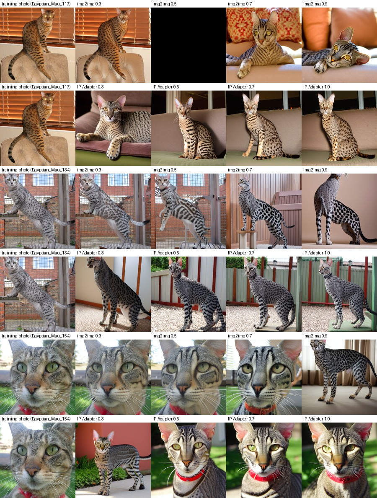

## What the contact sheets show (written before any Meeting 3 classifier result)

Each contact-sheet pair is source training photo → generated image; numbers
refer to the first 24 images of each pool.

**Image-to-image (the photo is the starting point)**

- **Strength 0.3 — near copies.** Same cat, pose, background and lighting; only
  fine texture changes. Even the photographers' signatures and watermarks are
  copied (#5, #20 "©Chamani", #2, #17). Because the 15 photos are reused about
  seven times each, a 0.3 pool is close to oversampling with slight noise.
- **Strength 0.5 — same scene, redrawn cat.** Pose and background stay; the coat
  and face are redrawn and often get sharper, more contrasted markings, sometimes
  stripes on legs and flanks (#6, #13). Watermarks are still reproduced, now as
  garbled text (#20). One attempt was safety-blocked (#1).
- **Strength 0.7 — new pose, old palette.** Colours and rough layout survive,
  but many images get a new pose or scene (#1 on a cushion, #3 among flowers,
  #21 on a patterned pillow). The coat starts to drift to the SD 1.5 look of
  Meeting 2: leopard-like spots (#14) and stripes.
- **Strength 0.9 — almost a text-to-image pool.** Only the colour palette is left;
  the Meeting 2 failures return: leopard/cheetah rosettes (#11, #14, #19),
  stripes (#21), odd anatomy and crops (#6, #7).

**IP-Adapter (the photo is a reference)**

- **Scale 0.3 — mostly the prompt.** New scenes and poses, similar to `m2-base`;
  the photo shows only in the overall colour (golden source #12 → golden cat).
- **Scale 0.5 — coat colour and details transfer.** Coat colour and the type of
  markings follow the source more, and details are copied: the red collar of the
  close-up source photo appears again (#10). Scenes are still new.
- **Scale 0.7–1.0 — the photo starts to dominate, with its own style.**
  Background colours and objects of the source come back (#6 fence and garden
  like the source's enclosure, #13 red sofa, #19/#20 studio backdrops, #21 fence),
  and the prompt matters less. The images get an over-contrasted look with very
  large black spots and long, serval-like bodies (#8, #23 at 1.0), and saturated
  colour casts (#3, #18 at 1.0). One attempt at scale 1.0 was safety-blocked (#2).

**Things that are copied but should not be:** watermarks and signatures
(img2img ≤ 0.5), collars (IP-Adapter ≥ 0.5, img2img at all strengths), and the
studio backdrops of the show-cat photos. They are not breed features, so a
classifier may learn them as shortcuts for "Egyptian Mau".

**The two modes move in opposite directions.** img2img keeps the *scene* (pose,
background, framing) and gives up the *cat* as strength grows; IP-Adapter keeps
the *cat's appearance* (coat colour, marking style) and invents a new scene,
copying more of the photo as the scale grows.


## Validation — every seed

| Run | Seed | Egyptian Mau recall | Macro-F1 | Accuracy |
| --- | ---: | ---: | ---: | ---: |
| m3-strength-0.3 | 0 | 0.7000 | 0.8916 | 0.8938 |
| m3-strength-0.3 | 1 | 0.6000 | 0.8841 | 0.8875 |
| m3-strength-0.3 | 2 | 0.7000 | 0.8856 | 0.8875 |
| m3-strength-0.3 | 3 | 0.7500 | 0.8936 | 0.8938 |
| m3-strength-0.3 | 4 | 0.7500 | 0.9056 | 0.9062 |
| **m3-strength-0.3** | **mean ± SD** | 0.7000 ± 0.0612 | 0.8921 ± 0.0085 | 0.8938 ± 0.0077 |
| m3-strength-0.5 | 0 | 0.7500 | 0.9054 | 0.9062 |
| m3-strength-0.5 | 1 | 0.7000 | 0.8986 | 0.9000 |
| m3-strength-0.5 | 2 | 0.8000 | 0.8933 | 0.8938 |
| m3-strength-0.5 | 3 | 0.8000 | 0.8939 | 0.8938 |
| m3-strength-0.5 | 4 | 0.8000 | 0.9060 | 0.9062 |
| **m3-strength-0.5** | **mean ± SD** | 0.7700 ± 0.0447 | 0.8994 ± 0.0061 | 0.9000 ± 0.0062 |
| m3-strength-0.7 | 0 | 0.8000 | 0.9122 | 0.9125 |
| m3-strength-0.7 | 1 | 0.7500 | 0.8935 | 0.8938 |
| m3-strength-0.7 | 2 | 0.7000 | 0.8924 | 0.8938 |
| m3-strength-0.7 | 3 | 0.8000 | 0.8939 | 0.8938 |
| m3-strength-0.7 | 4 | 0.7500 | 0.8995 | 0.9000 |
| **m3-strength-0.7** | **mean ± SD** | 0.7600 ± 0.0418 | 0.8983 ± 0.0083 | 0.8988 ± 0.0081 |
| m3-strength-0.9 | 0 | 0.8500 | 0.9184 | 0.9187 |
| m3-strength-0.9 | 1 | 0.8000 | 0.9000 | 0.9000 |
| m3-strength-0.9 | 2 | 0.7500 | 0.8986 | 0.9000 |
| m3-strength-0.9 | 3 | 0.8500 | 0.9068 | 0.9062 |
| m3-strength-0.9 | 4 | 0.8000 | 0.9061 | 0.9062 |
| **m3-strength-0.9** | **mean ± SD** | 0.8100 ± 0.0418 | 0.9060 ± 0.0079 | 0.9062 ± 0.0077 |
| m3-ip-0.3 | 0 | 0.8000 | 0.9057 | 0.9062 |
| m3-ip-0.3 | 1 | 0.6500 | 0.8801 | 0.8812 |
| m3-ip-0.3 | 2 | 0.6500 | 0.8852 | 0.8875 |
| m3-ip-0.3 | 3 | 0.8000 | 0.9003 | 0.9000 |
| m3-ip-0.3 | 4 | 0.7500 | 0.9060 | 0.9062 |
| **m3-ip-0.3** | **mean ± SD** | 0.7300 ± 0.0758 | 0.8955 ± 0.0121 | 0.8962 ± 0.0114 |
| m3-ip-0.5 | 0 | 0.7500 | 0.8992 | 0.9000 |
| m3-ip-0.5 | 1 | 0.6500 | 0.8801 | 0.8812 |
| m3-ip-0.5 | 2 | 0.6500 | 0.8793 | 0.8812 |
| m3-ip-0.5 | 3 | 0.8000 | 0.9065 | 0.9062 |
| m3-ip-0.5 | 4 | 0.7500 | 0.9060 | 0.9062 |
| **m3-ip-0.5** | **mean ± SD** | 0.7200 ± 0.0671 | 0.8943 ± 0.0136 | 0.8950 ± 0.0128 |
| m3-ip-0.7 | 0 | 0.7500 | 0.8929 | 0.8938 |
| m3-ip-0.7 | 1 | 0.6500 | 0.8801 | 0.8812 |
| m3-ip-0.7 | 2 | 0.6500 | 0.8793 | 0.8812 |
| m3-ip-0.7 | 3 | 0.8000 | 0.8940 | 0.8938 |
| m3-ip-0.7 | 4 | 0.7500 | 0.9179 | 0.9187 |
| **m3-ip-0.7** | **mean ± SD** | 0.7200 ± 0.0671 | 0.8928 ± 0.0156 | 0.8938 ± 0.0153 |
| m3-ip-1.0 | 0 | 0.7000 | 0.8859 | 0.8875 |
| m3-ip-1.0 | 1 | 0.6000 | 0.8669 | 0.8688 |
| m3-ip-1.0 | 2 | 0.6500 | 0.8978 | 0.9000 |
| m3-ip-1.0 | 3 | 0.8000 | 0.9003 | 0.9000 |
| m3-ip-1.0 | 4 | 0.7000 | 0.9049 | 0.9062 |
| **m3-ip-1.0** | **mean ± SD** | 0.6900 ± 0.0742 | 0.8912 ± 0.0153 | 0.8925 ± 0.0149 |

### Summary (Δ against the Meeting 2 pool `m2-base`)

| Run | Mau recall (mean ± SD) | Macro-F1 (mean ± SD) | Δ Mau recall vs m2-base, pp (paired SD; seeds +/=/−) | Δ macro-F1 vs m2-base, pp | Mau→Bengal per model | Other breeds→Mau per model |
| --- | ---: | ---: | ---: | ---: | ---: | ---: |
| m1-real | 0.480 ± 0.076 | 0.857 ± 0.011 | – | – | 5.2 | 0.2 |
| m1-oversample | 0.670 ± 0.057 | 0.883 ± 0.016 | – | – | 2.4 | 1.2 |
| m1-augment-strong | 0.680 ± 0.091 | 0.887 ± 0.013 | – | – | 2.6 | 2.0 |
| m2-base | 0.810 ± 0.055 | 0.907 ± 0.009 | – | – | 1.8 | 0.6 |
| m3-strength-0.3 | 0.700 ± 0.061 | 0.892 ± 0.009 | -11.0 (6.5; 0/0/5) | -1.53 | 2.2 | 1.6 |
| m3-strength-0.5 | 0.770 ± 0.045 | 0.899 ± 0.006 | -4.0 (6.5; 1/1/3) | -0.80 | 1.6 | 1.6 |
| m3-strength-0.7 | 0.760 ± 0.042 | 0.898 ± 0.008 | -5.0 (3.5; 0/1/4) | -0.92 | 2.0 | 1.2 |
| m3-strength-0.9 | 0.810 ± 0.042 | 0.906 ± 0.008 | -0.0 (3.5; 1/3/1) | -0.15 | 1.8 | 1.2 |
| m3-ip-0.3 | 0.730 ± 0.076 | 0.895 ± 0.012 | -8.0 (5.7; 0/1/4) | -1.20 | 2.0 | 0.6 |
| m3-ip-0.5 | 0.720 ± 0.067 | 0.894 ± 0.014 | -9.0 (4.2; 0/0/5) | -1.32 | 2.0 | 0.6 |
| m3-ip-0.7 | 0.720 ± 0.067 | 0.893 ± 0.016 | -9.0 (4.2; 0/0/5) | -1.46 | 2.0 | 0.6 |
| m3-ip-1.0 | 0.690 ± 0.074 | 0.891 ± 0.015 | -12.0 (4.5; 0/0/5) | -1.63 | 2.4 | 0.4 |

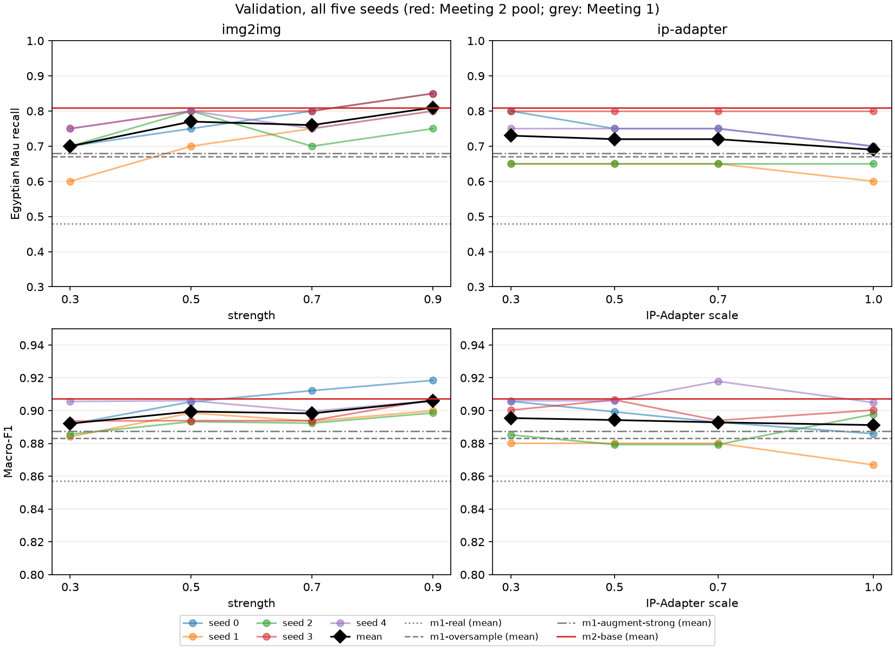

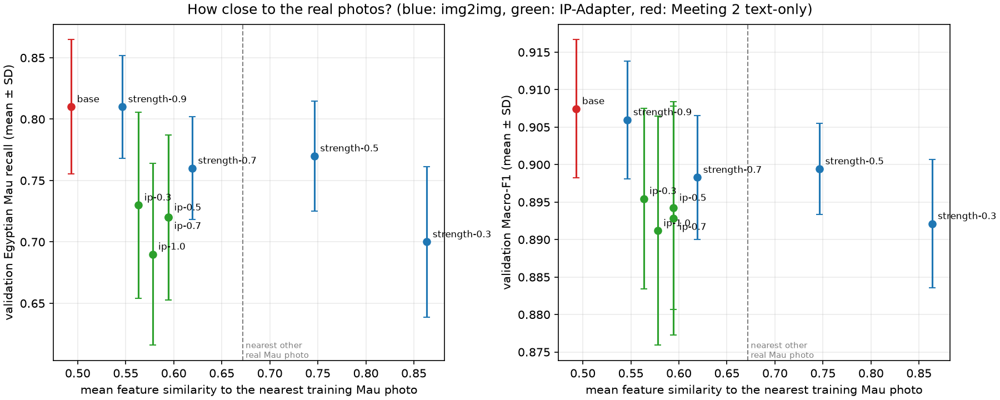

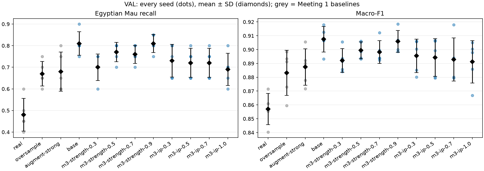

### How close to the real photos should the images be? (written before testing)

**Closer is not better.** On the validation photos the classifier gains most
from images that are *far* from the 15 training photos, and least from near
copies:

- **img2img improves as strength grows**: Mau recall 0.70 → 0.77 → 0.76 → 0.81
  for strength 0.3 → 0.9, and macro-F1 0.892 → 0.906. Strength 0.3 (feature
  similarity 0.86 to its source, closer than any two real Mau photos are to each
  other, 0.67) behaves like oversampling (0.67): seven near-copies of each of the
  same 15 cats add almost no new information. It is also the only img2img pool
  that is worse than `m2-base` in every seed (−11 pp, 0/0/5).
- **Strength 0.9 is as good as the text-only Meeting 2 pool** (0.81, paired
  difference 0.0 pp, 1/3/1 seeds), and it is the pool with the lowest similarity
  to the training photos (0.55, only a little above `m2-base`'s 0.49). At this
  strength only the colour palette of the source survives, so it is effectively a
  text-to-image pool with a photo-derived colour scheme.
- **IP-Adapter gets slightly worse as the scale grows** (0.73, 0.72, 0.72, 0.69)
  and is below `m2-base` at every scale (−8 to −12 pp; lower in 4–5 of 5 seeds),
  though still above or at the Meeting 1 baselines. Its similarity to the
  training photos hardly changes with the scale (0.56–0.59), so the photo
  conditioning mostly changes the *style* of the images, not how close they are.
- **What separates the pools is not captured by the two simple measures.**
  IP-Adapter at scale 1.0 is about as far from the photos (0.58) and as diverse
  (within-pool similarity 0.52) as img2img 0.9 (0.55, 0.51) and `m2-base` (0.49,
  0.52), but its recall is 12 pp lower. The contact sheets suggest why:
  IP-Adapter images have an over-contrasted, graphic look with very large black
  spots, long serval-like bodies and saturated colour casts, and they copy studio
  backdrops and collars. This resembles the guidance-15 pool of Meeting 2 (also
  −5 pp). Natural, photo-like images of *new* cats seem to matter more than
  closeness to the training photos.
- **Cost.** img2img pools also make the models call more other cats Mau
  (1.2–1.6 per model against 0.6 for `m2-base` and the IP-Adapter pools),
  i.e. part of their recall is bought with false positives; macro-F1 shows this
  as a 0.15–1.5 pp loss against `m2-base`.
- **Spread.** Five seeds and 20 validation Mau photos (5 pp each): the IP-Adapter
  pools differ from each other by at most one photo on average. The robust
  findings are the ends of the img2img sweep (near copies ≈ oversampling;
  strength 0.9 ≈ text-to-image) and IP-Adapter being consistently below `m2-base`.

**Answer.** For this classifier the useful images are *about as far from the
training photos as another real Egyptian Mau would be, or further* (similarity
≤ 0.6 here), as long as they still look like real photographs of the breed.
Near copies (img2img ≤ 0.5) mostly repeat the 15 cats, including their
watermarks and collars.

**Choices** (fixed rule: highest mean validation Mau recall per mode):
`m3-strength-0.9` for image-to-image and `m3-ip-0.3` for IP-Adapter. Neither is
better than the Meeting 2 pool on validation; they are tested as the best run of
each mode, as the assignment asks.


### Pools taken forward (written before testing)

By the fixed rule (Per mode: highest mean validation Mau recall; tie: macro-F1; then the 0.5 pool.): **m3-strength-0.9** for
image-to-image and **m3-ip-0.3** for IP-Adapter, recorded
at 2026-11-07T10:22:58.534048+00:00 in `evidence/m3-decision.json` with hashes of every
Meeting 3 validation file.

## Test — chosen runs against Meetings 1 and 2

| Run | Seed | Egyptian Mau recall | Macro-F1 | Accuracy |
| --- | ---: | ---: | ---: | ---: |
| m1-real | 0 | 0.4667 | 0.8472 | 0.8542 |
| m1-real | 1 | 0.5333 | 0.8541 | 0.8583 |
| m1-real | 2 | 0.4667 | 0.8602 | 0.8667 |
| m1-real | 3 | 0.4333 | 0.8541 | 0.8625 |
| m1-real | 4 | 0.6333 | 0.8723 | 0.8750 |
| **m1-real** | **mean ± SD** | 0.5067 ± 0.0796 | 0.8576 ± 0.0094 | 0.8633 ± 0.0080 |
| m1-oversample | 0 | 0.7000 | 0.8823 | 0.8833 |
| m1-oversample | 1 | 0.6667 | 0.8734 | 0.8750 |
| m1-oversample | 2 | 0.7000 | 0.8860 | 0.8875 |
| m1-oversample | 3 | 0.7000 | 0.8909 | 0.8917 |
| m1-oversample | 4 | 0.7000 | 0.8698 | 0.8708 |
| **m1-oversample** | **mean ± SD** | 0.6933 ± 0.0149 | 0.8805 ± 0.0088 | 0.8817 ± 0.0086 |
| m1-augment-strong | 0 | 0.6333 | 0.8686 | 0.8708 |
| m1-augment-strong | 1 | 0.6000 | 0.8560 | 0.8583 |
| m1-augment-strong | 2 | 0.7000 | 0.8904 | 0.8917 |
| m1-augment-strong | 3 | 0.6667 | 0.8784 | 0.8792 |
| m1-augment-strong | 4 | 0.6667 | 0.8693 | 0.8708 |
| **m1-augment-strong** | **mean ± SD** | 0.6533 ± 0.0380 | 0.8725 ± 0.0128 | 0.8742 ± 0.0123 |
| m2-base | 0 | 0.7333 | 0.9033 | 0.9042 |
| m2-base | 1 | 0.8000 | 0.8924 | 0.8917 |
| m2-base | 2 | 0.7333 | 0.8914 | 0.8917 |
| m2-base | 3 | 0.7333 | 0.8961 | 0.8958 |
| m2-base | 4 | 0.7333 | 0.8828 | 0.8833 |
| **m2-base** | **mean ± SD** | 0.7467 ± 0.0298 | 0.8932 ± 0.0074 | 0.8933 ± 0.0076 |
| m3-strength-0.9 | 0 | 0.7667 | 0.9040 | 0.9042 |
| m3-strength-0.9 | 1 | 0.7667 | 0.8919 | 0.8917 |
| m3-strength-0.9 | 2 | 0.8000 | 0.8959 | 0.8958 |
| m3-strength-0.9 | 3 | 0.7000 | 0.8874 | 0.8875 |
| m3-strength-0.9 | 4 | 0.8000 | 0.8751 | 0.8750 |
| **m3-strength-0.9** | **mean ± SD** | 0.7667 ± 0.0408 | 0.8909 ± 0.0107 | 0.8908 ± 0.0108 |
| m3-ip-0.3 | 0 | 0.8000 | 0.8963 | 0.8958 |
| m3-ip-0.3 | 1 | 0.7333 | 0.8791 | 0.8792 |
| m3-ip-0.3 | 2 | 0.8000 | 0.9040 | 0.9042 |
| m3-ip-0.3 | 3 | 0.7000 | 0.8914 | 0.8917 |
| m3-ip-0.3 | 4 | 0.7333 | 0.8790 | 0.8792 |
| **m3-ip-0.3** | **mean ± SD** | 0.7533 ± 0.0447 | 0.8899 ± 0.0109 | 0.8900 ± 0.0109 |

| Run | Mau recall (mean ± SD) | Macro-F1 (mean ± SD) | Mau→Bengal per model | Other breeds→Mau per model |
| --- | ---: | ---: | ---: | ---: |
| m1-real | 0.507 ± 0.080 | 0.858 ± 0.009 | 9.0 | 0.0 |
| m1-oversample | 0.693 ± 0.015 | 0.880 ± 0.009 | 4.2 | 0.4 |
| m1-augment-strong | 0.653 ± 0.038 | 0.873 ± 0.013 | 4.2 | 0.0 |
| m2-base | 0.747 ± 0.030 | 0.893 ± 0.007 | 4.4 | 0.4 |
| m3-strength-0.9 | 0.767 ± 0.041 | 0.891 ± 0.011 | 4.4 | 0.6 |
| m3-ip-0.3 | 0.753 ± 0.045 | 0.890 ± 0.011 | 4.0 | 0.6 |

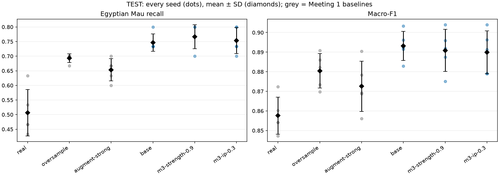

Paired by training seed (one test Mau photo = 3.3 pp):

- **m3-strength-0.9** versus **m1-oversample**: Mau recall +7.3 pp (paired SD 4.3; higher/equal/lower in 4/1/0 seeds); macro-F1 +1.04 pp.
- **m3-strength-0.9** versus **m2-base**: Mau recall +2.0 pp (paired SD 5.1; higher/equal/lower in 3/0/2 seeds); macro-F1 -0.23 pp.
- **m3-ip-0.3** versus **m1-oversample**: Mau recall +6.0 pp (paired SD 4.3; higher/equal/lower in 4/1/0 seeds); macro-F1 +0.95 pp.
- **m3-ip-0.3** versus **m2-base**: Mau recall +0.7 pp (paired SD 6.0; higher/equal/lower in 2/1/2 seeds); macro-F1 -0.33 pp.

### What the test results show

- **Both chosen runs beat the Meeting 1 baselines on test** and match the
  Meeting 2 pool: Mau recall 0.767 (`m3-strength-0.9`) and 0.753 (`m3-ip-0.3`)
  against 0.747 (`m2-base`) and 0.693 (oversampling); macro-F1 0.891 and 0.890
  against 0.893 and 0.881. Against oversampling both are higher or equal in every
  seed (+7.3 and +6.0 pp).
- **Against the Meeting 2 pool there is no real difference.** +2.0 pp and
  +0.7 pp Mau recall are less than one test photo (3.3 pp) per model, the seeds
  split 3/0/2 and 2/1/2, and macro-F1 is 0.2–0.3 pp lower. Conditioning the
  generation on the training photos did not add anything measurable on top of
  text-to-image.
- **IP-Adapter's validation gap did not replicate.** On validation `m3-ip-0.3` was
  8 pp below `m2-base`; on test it is 0.7 pp above. With 20–30 Mau photos per
  split, differences of a few photos between generation methods are within noise;
  only the gap between synthetic pools and the classical baselines is consistent
  on both splits.
- **Remaining errors** are the same as before: about 4 of 30 test Mau photos per
  model are called Bengal for every synthetic pool. img2img 0.9 reduces the
  Mau→Russian Blue confusions a little further (1.4 against 2.0 for `m2-base` and
  3.6 for oversampling).

Mean number of the 30 test Mau photos per model predicted as each other breed:

| Run | Bengal | Russian Blue | Abyssinian | Siamese |
| --- | ---: | ---: | ---: | ---: |
| m1-oversample | 4.2 | 3.6 | 1.2 | 0.2 |
| m2-base | 4.4 | 2.0 | 1.2 | 0.0 |
| m3-strength-0.9 | 4.4 | 1.4 | 1.2 | 0.0 |
| m3-ip-0.3 | 4.0 | 2.2 | 1.2 | 0.0 |

**Result carried forward:** best image-to-image run `m3-strength-0.9` — test Mau
recall 0.767 ± 0.041, macro-F1 0.891 ± 0.011; best IP-Adapter run `m3-ip-0.3` —
0.753 ± 0.045, macro-F1 0.890 ± 0.011. Both are on par with `m2-base`
(0.747 ± 0.030, 0.893 ± 0.007) and above every Meeting 1 baseline.

Test results are a final measurement; the validation decisions remain unchanged.
