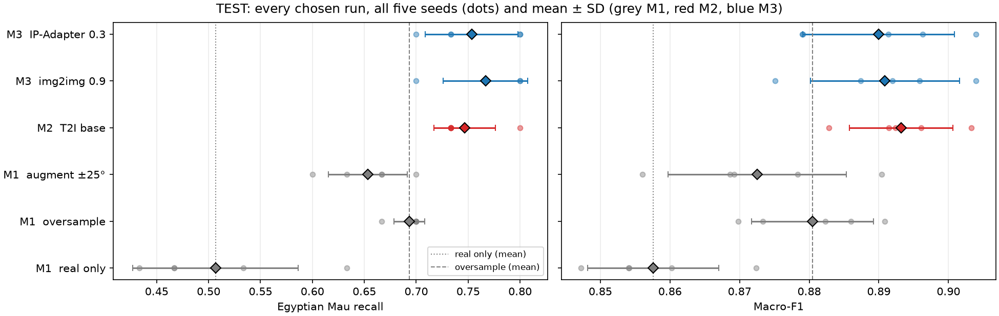
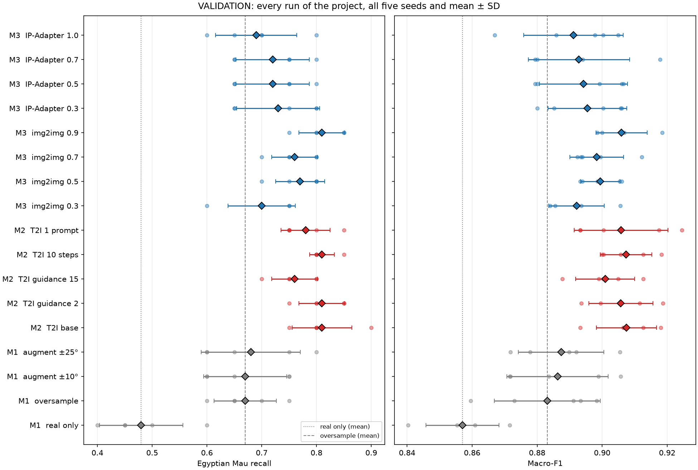
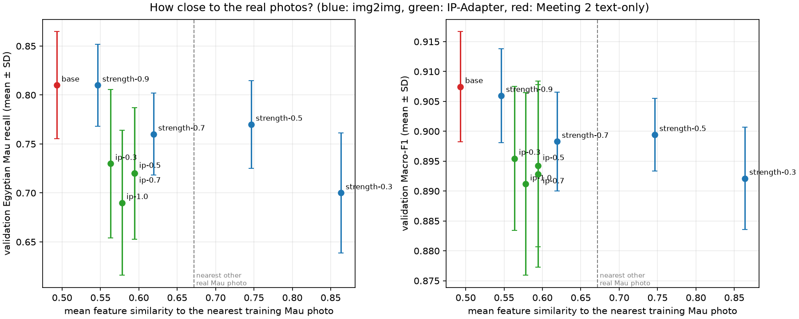
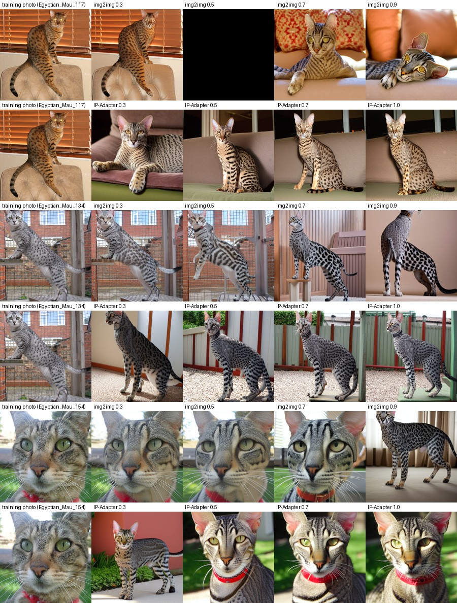
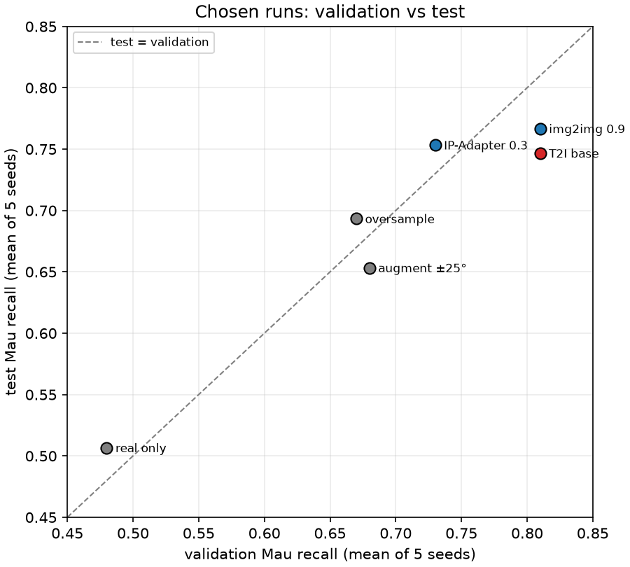
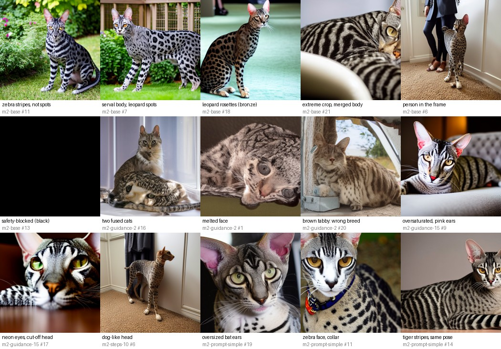

# Project Summary — Synthetic Data for an Under-Represented Cat Breed

Author: **Mikołaj Zwiefka** · Status: Meetings 1–3 complete (updated after each meeting)

This page summarises the whole project so far: what each method does, how the
methods compare, and what we learned. Full details, per-seed tables and every
decision are in [EXPERIMENTS.md](EXPERIMENTS.md); the pre-registered plans are in
[protocol.md](protocol.md), [protocol-m2.md](protocol-m2.md) and
[protocol-m3.md](protocol-m3.md).

## 1. The question

> Can images made by diffusion models improve recognition of **Egyptian Mau**,
> an under-represented cat breed, without harming the other seven breeds?

A classifier for eight cat breeds (Oxford-IIIT Pet) is trained on 70 photos of
each breed but only **15 Egyptian Mau** photos. Every method adds exactly
**55 Egyptian Mau training examples**, so the minority class reaches 70. Only
the way those 55 examples are made changes from method to method.

## 2. Fixed experimental setup

| Item | Setting |
| --- | --- |
| Data split (`data/split.csv`, never changed) | train 70 per breed / 15 Mau · validation 20 per breed · test 30 per breed |
| Classifier | EfficientNet-B0 (ImageNet weights), fine-tuned 8 epochs, AdamW, batch 64 |
| Repetitions | 5 training seeds (0–4) per run; seeds differ in initialisation, data order and which 55 images are drawn |
| Main metric | **Egyptian Mau recall** (share of Mau photos recognised) |
| Guardrail | **Macro-F1** over all eight breeds (catches harm to other breeds) |
| Diagnostics | Mau photos predicted as Bengal / Russian Blue; other breeds predicted as Mau |
| Protocol | choose on **validation**, write the choice down (with file hashes), then evaluate only the chosen runs on **test** |
| Hardware | RTX 4060 Laptop GPU (8 GB), Python 3.13, PyTorch 2.14 + CUDA 13.0, diffusers 0.40 |

Reading the numbers: one validation Mau photo is **5 pp** of recall, one test
Mau photo is **3.3 pp**. Differences smaller than one or two photos, or smaller
than the seed spread, are not evidence.

## 3. The methods and how they work

| Meeting | Method | What the 55 extra Mau examples are | Setting(s) explored |
| :-: | --- | --- | --- |
| 1 | Real only | nothing added (reference) | – |
| 1 | Oversampling | exact repeats of the 15 photos, spread evenly (10 photos ×4, 5 photos ×3) | – |
| 1 | Augmentation | randomly transformed copies of the 15 photos (flip, rotation, colour jitter), re-drawn every epoch | rotation ±10° vs ±25° |
| 2 | Text-to-image | new images from Stable Diffusion 1.5, generated only from a text prompt | guidance (2 / 7.5 / 15), steps (10 / 30), prompt (4 varied / 1 simple) |
| 3 | Image-to-image | a training photo is noised and then denoised with the prompt; *strength* = how much of the photo is replaced | strength 0.3 / 0.5 / 0.7 / 0.9 |
| 3 | IP-Adapter | a training photo is a *reference* the model looks at while drawing a new image from the prompt | scale 0.3 / 0.5 / 0.7 / 1.0 |

Generation settings, in one sentence each: **guidance** controls how strictly
the image follows the prompt; **steps** is how many denoising steps the sampler
takes; **strength** (img2img) sets how far from the source photo the result may
move (near 0 = copy, near 1 = new image); **IP-Adapter scale** sets how strongly
the reference photo steers the new image. Each generated pool holds 110 images;
each training seed draws a different random 55 of them. Image *i* of every pool
uses the same seed (and, in Meeting 3, the same source photo), so pools can be
compared image by image.

## 4. Headline result — test set, every chosen run

<!-- BEGIN:tested -->
| Meeting | Method | Test Mau recall | Test macro-F1 | Δ recall vs real, pp (seeds +/=/−) | Δ recall vs oversample, pp (seeds +/=/−) | Mau→Bengal | Mau→Russian Blue | Other breeds→Mau |
| :-: | --- | ---: | ---: | ---: | ---: | ---: | ---: | ---: |
| 1 | real only (`m1-real`) | 0.507 ± 0.080 | 0.858 ± 0.009 | – | -18.7 (0/0/5) | 9.0 | 5.0 | 0.0 |
| 1 | oversample (`m1-oversample`) | 0.693 ± 0.015 | 0.880 ± 0.009 | +18.7 (5/0/0) | – | 4.2 | 3.6 | 0.4 |
| 1 | augment ±25° (`m1-augment-strong`) | 0.653 ± 0.038 | 0.873 ± 0.013 | +14.7 (5/0/0) | -4.0 (0/1/4) | 4.2 | 4.4 | 0.0 |
| 2 | T2I base (`m2-base`) | 0.747 ± 0.030 | 0.893 ± 0.007 | +24.0 (5/0/0) | +5.3 (5/0/0) | 4.4 | 2.0 | 0.4 |
| 3 | img2img 0.9 (`m3-strength-0.9`) | 0.767 ± 0.041 | 0.891 ± 0.011 | +26.0 (5/0/0) | +7.3 (4/1/0) | 4.4 | 1.4 | 0.6 |
| 3 | IP-Adapter 0.3 (`m3-ip-0.3`) | 0.753 ± 0.045 | 0.890 ± 0.011 | +24.7 (5/0/0) | +6.0 (4/1/0) | 4.0 | 2.2 | 0.6 |
<!-- END:tested -->

Mean ± SD over 5 seeds; Δ columns are paired by seed. "Mau→Bengal" and
"Mau→Russian Blue" are the mean numbers of the 30 test Mau photos per model
predicted as that breed; "Other breeds→Mau" is the mean number of the 210 other
test photos predicted as Mau.

**In short:**

1. **Synthetic images from diffusion models beat both classical fixes.** All
   three tested diffusion runs reach 0.75–0.77 test Mau recall against 0.69 for
   oversampling and 0.65 for augmentation, and they are higher than or equal to
   oversampling in every seed.
2. **The other breeds are not harmed.** Macro-F1 rises from 0.858 (real only)
   and 0.880 (oversampling) to 0.890–0.893, and the number of other cats wrongly
   called Mau stays below one per model.
3. **The three diffusion approaches are on par.** Text-to-image, img2img 0.9 and
   IP-Adapter 0.3 differ by at most 2 pp, i.e. less than one test photo.
4. **Bengal remains the main confusion.** All methods leave about 4 of the 30 test
   Mau photos classified as Bengal. The extra gain of the diffusion pools comes
   from fewer Mau photos called Russian Blue (1.4–2.2 against 3.6 for oversampling).

## 5. Every run of the project — validation

<!-- BEGIN:all -->
| Meeting | Method | How the 55 extra Mau examples are made | Val Mau recall | Val macro-F1 | Similarity to nearest training Mau photo | Tested |
| :-: | --- | --- | ---: | ---: | ---: | :-: |
| 1 | real only | none (15 Mau photos only) | 0.480 ± 0.076 | 0.857 ± 0.011 | – | ✔ |
| 1 | oversample | exact repeats of the 15 photos | 0.670 ± 0.057 | 0.883 ± 0.016 | – | ✔ |
| 1 | augment ±10° | random flips/rotations/colour jitter of the 15 | 0.670 ± 0.076 | 0.886 ± 0.016 | – |  |
| 1 | augment ±25° | as above, rotation up to ±25° | 0.680 ± 0.091 | 0.887 ± 0.013 | – | ✔ |
| 2 | T2I base | SD 1.5 text-to-image, 4 prompts, 30 steps, g=7.5 | 0.810 ± 0.055 | 0.907 ± 0.009 | 0.49 | ✔ |
| 2 | T2I guidance 2 | base with guidance 2 | 0.810 ± 0.042 | 0.906 ± 0.010 | – |  |
| 2 | T2I guidance 15 | base with guidance 15 | 0.760 ± 0.042 | 0.901 ± 0.009 | – |  |
| 2 | T2I 10 steps | base with 10 steps | 0.810 ± 0.022 | 0.907 ± 0.008 | – |  |
| 2 | T2I 1 prompt | base with one simple prompt | 0.780 ± 0.045 | 0.906 ± 0.014 | – |  |
| 3 | img2img 0.3 | img2img from a training photo, strength 0.3 | 0.700 ± 0.061 | 0.892 ± 0.009 | 0.86 |  |
| 3 | img2img 0.5 | img2img, strength 0.5 | 0.770 ± 0.045 | 0.899 ± 0.006 | 0.75 |  |
| 3 | img2img 0.7 | img2img, strength 0.7 | 0.760 ± 0.042 | 0.898 ± 0.008 | 0.62 |  |
| 3 | img2img 0.9 | img2img, strength 0.9 | 0.810 ± 0.042 | 0.906 ± 0.008 | 0.55 | ✔ |
| 3 | IP-Adapter 0.3 | IP-Adapter with a training photo, scale 0.3 | 0.730 ± 0.076 | 0.895 ± 0.012 | 0.56 | ✔ |
| 3 | IP-Adapter 0.5 | IP-Adapter, scale 0.5 | 0.720 ± 0.067 | 0.894 ± 0.014 | 0.59 |  |
| 3 | IP-Adapter 0.7 | IP-Adapter, scale 0.7 | 0.720 ± 0.067 | 0.893 ± 0.016 | 0.59 |  |
| 3 | IP-Adapter 1.0 | IP-Adapter, scale 1.0 | 0.690 ± 0.074 | 0.891 ± 0.015 | 0.58 |  |
<!-- END:all -->

"Similarity" is the mean cosine similarity of ImageNet EfficientNet-B0 features
between a generated image and the nearest of the 15 training Mau photos
(1 = identical). For reference, a real training photo has similarity **0.67** to
its nearest *other* real training photo. ✔ = evaluated on test.

## 6. Comparisons

### 6.1 Classical fixes (Meeting 1): repetition helps, transformation adds nothing

Both oversampling and augmentation raise validation Mau recall from 0.48 to
0.67–0.68 (+19 pp, in every seed) and macro-F1 by about 3 pp. Augmentation is
**not** better than plain repetition: the starter already applies random crops,
flips and colour changes to every training image, so extra transforms of the
same 15 cats add little new information. Stronger rotation (±25° vs ±10°)
changed recall by +1 pp (one seed of five), which is noise. On test,
oversampling (0.693) ended up slightly ahead of augmentation (0.653).

### 6.2 Classical vs synthetic

The best classical run and every diffusion run, side by side on test:

| | Oversampling | Text-to-image | img2img 0.9 | IP-Adapter 0.3 |
| --- | ---: | ---: | ---: | ---: |
| New cats? | no – same 15 | yes | yes (only colours from a photo) | yes (look of a photo) |
| New poses / backgrounds? | no | yes | yes | yes |
| Test Mau recall | 0.693 | 0.747 | **0.767** | 0.753 |
| Test macro-F1 | 0.880 | **0.893** | 0.891 | 0.890 |
| Cost per 110 images | 0 s | ≈ 7.5 min | ≈ 7.5 min | ≈ 8 min |

Repeating 15 cats cannot teach the classifier about the variation it meets in new
photos; 55 *different-looking* spotted cats can, even though many of them have
visible defects (Section 7).

### 6.3 Text-to-image settings (Meeting 2): small effects, one clear loser

| Setting changed (vs base) | Δ val Mau recall, pp | Δ val macro-F1, pp | What changed in the images |
| --- | ---: | ---: | --- |
| Guidance 2 | 0.0 | −0.2 | more natural light, but more wrong-breed brown tabbies and fused bodies; more false Mau predictions |
| **Guidance 15** | **−5.0** (lower in 4/5 seeds) | −0.7 | oversaturated, graphic, illustration-like |
| 10 steps | 0.0 | 0.0 | almost identical to 30 steps (DPM solver), 3× cheaper |
| One simple prompt | −3.0 | −0.2 | plausible coats but the same pose and background again and again |

Lesson: **realism and variety of the images matter more than any single knob**;
exaggerated, graphic images (high guidance) and repetitive images (one prompt)
help less.

### 6.4 How close to the real photos? (Meeting 3)

| Pool | Similarity to training photos | Val Mau recall | What the images are |
| --- | ---: | ---: | --- |
| img2img 0.3 | 0.86 | 0.70 | near copies (≈ oversampling), even watermarks copied |
| img2img 0.5 | 0.75 | 0.77 | same scene, redrawn cat |
| *another real Mau photo* | *0.67* | | *reference* |
| img2img 0.7 | 0.62 | 0.76 | new pose, palette of the photo |
| IP-Adapter 0.3–1.0 | 0.56–0.59 | 0.73–0.69 | new scene, the photo's coat look, over-contrasted |
| img2img 0.9 | 0.55 | **0.81** | effectively a new image |
| Text-to-image (M2) | 0.49 | **0.81** | new image from text only |

**Closer is not better.** Near copies of the training photos behave like
oversampling; the most useful images are at least as different from the 15
training photos as another real Egyptian Mau would be, as long as they still look
like natural photographs. The two modes move in opposite directions: img2img keeps
the *scene* and gives up the *cat* as strength grows; IP-Adapter keeps the *cat's
look* and invents a new scene. IP-Adapter was below text-to-image on validation
at every scale, although its images are just as far from the photos and just as
diverse; the likely reason is their over-contrasted, graphic style (as with
guidance 15). On test, however, this gap disappeared (Section 6.6).

### 6.5 Effect on every breed (test recall, mean of 5 seeds; best per row in bold)

<!-- BEGIN:breeds -->
| Breed | real only | oversample | augment ±25° | T2I base | img2img 0.9 | IP-Adapter 0.3 |
| --- | ---: | ---: | ---: | ---: | ---: | ---: |
| Abyssinian | **0.947** | 0.913 | 0.933 | 0.927 | 0.920 | 0.907 |
| Bengal | **0.933** | 0.893 | 0.907 | 0.913 | 0.887 | 0.893 |
| Birman | **0.920** | **0.920** | 0.913 | 0.913 | 0.913 | 0.913 |
| Bombay | 0.980 | **0.993** | 0.973 | 0.960 | 0.960 | 0.973 |
| Egyptian Mau | 0.507 | 0.693 | 0.653 | 0.747 | **0.767** | 0.753 |
| Ragdoll | 0.887 | 0.893 | 0.880 | **0.900** | **0.900** | 0.893 |
| Russian Blue | 0.867 | 0.847 | 0.840 | 0.873 | 0.867 | **0.880** |
| Siamese | 0.867 | 0.900 | 0.893 | **0.913** | **0.913** | 0.907 |
<!-- END:breeds -->

Egyptian Mau gains 15–26 pp. Abyssinian and Bengal lose up to 4–5 pp against
the real-only model (at most about 1.4 test photos per model) with every added
method, classical or synthetic; Siamese, Ragdoll and Russian Blue gain slightly.
Overall macro-F1 rises for every method, so the trade is clearly positive.

### 6.6 Validation vs test — how reliable are the choices?

<!-- BEGIN:valtest -->
| Method | Val Mau recall | Test Mau recall | Test − val, pp | Val macro-F1 | Test macro-F1 |
| --- | ---: | ---: | ---: | ---: | ---: |
| real only | 0.480 | 0.507 | +2.7 | 0.857 | 0.858 |
| oversample | 0.670 | 0.693 | +2.3 | 0.883 | 0.880 |
| augment ±25° | 0.680 | 0.653 | -2.7 | 0.887 | 0.873 |
| T2I base | 0.810 | 0.747 | -6.3 | 0.907 | 0.893 |
| img2img 0.9 | 0.810 | 0.767 | -4.3 | 0.906 | 0.891 |
| IP-Adapter 0.3 | 0.730 | 0.753 | +2.3 | 0.895 | 0.890 |
<!-- END:valtest -->

The runs chosen as the *best of several pools* (text-to-image base, img2img 0.9)
score 4–6 pp lower on test than on validation: picking the maximum of several
noisy estimates on only 20 validation Mau photos is optimistic. IP-Adapter 0.3,
which was not the best on validation, does slightly better on test. The large
effect — synthetic vs classical — replicates on both splits; the small
differences between generation settings do not reliably replicate.

## 7. What the generated images get wrong

| Failure | Where it appears most | Why it matters |
| --- | --- | --- |
| Stripes instead of spots (tabby/zebra coat) | prompts containing "tabby", guidance 15, img2img ≥ 0.7 | Mau has random spots; stripes belong to other cats |
| Serval / leopard / Bengal look (huge ears, long legs, rosettes) | every text-to-image pool, IP-Adapter ≥ 0.7 | pushes the Mau class towards Bengal — the main remaining confusion |
| Impossible anatomy (fused bodies, melted faces, dog-like heads) | guidance 2, 10 steps | not a real cat at all |
| Over-processed / graphic style | guidance 15, IP-Adapter ≥ 0.7 | looks unlike the real photos; these pools helped least |
| Repeated pose and background | one simple prompt | less variety per added image |
| Copied photo details (watermarks, collars, studio backdrops) | img2img ≤ 0.5, IP-Adapter ≥ 0.5 | shortcuts that are not breed features |
| Safety-blocked black images | 9 of 1,430 attempts | kept in the manifests, never used for training |

## 8. Current references for the next meetings (test)

| Reference | Test Mau recall | Test macro-F1 |
| --- | ---: | ---: |
| Real data only | 0.507 ± 0.080 | 0.858 ± 0.009 |
| Best classical (oversampling) | 0.693 ± 0.015 | 0.880 ± 0.009 |
| Text-to-image (`m2-base`) | 0.747 ± 0.030 | 0.893 ± 0.007 |
| Best image-to-image (`m3-strength-0.9`) | **0.767 ± 0.041** | 0.891 ± 0.011 |
| Best IP-Adapter (`m3-ip-0.3`) | 0.753 ± 0.045 | 0.890 ± 0.011 |

Open problems for later meetings: the Mau/Bengal boundary (≈ 4 of 30 test Mau
photos per model), keeping images realistic while making them diverse, and the
small size of the evaluation sets, which makes differences below about 5 pp
hard to establish.

## 9. Limitations

- **Small evaluation sets.** 20 validation and 30 test Mau photos; five seeds
  measure training randomness only, not uncertainty over new data.
- **One fixed split and one classifier.** Results may differ for other splits,
  architectures or breeds.
- **Closeness measure is a proxy.** ImageNet features capture overall
  appearance, not breed-specific coat patterns; they did not explain why
  IP-Adapter pools were weaker on validation.
- **Environment.** Measurements use the locally installed CUDA 13.0 PyTorch
  rather than the template's `uv.lock`; exact versions are in
  `requirements-runtime.txt`. The planned SDXL-Turbo pool was dropped before any
  result was seen (the assignment requires three changed settings; four were run).

## 10. Reproduce and find things

| What | Where |
| --- | --- |
| Balancing code (oversample, augment) | `src/synthdata/balance.py` |
| Generation + training commands | `scripts/run_m2.py`, `scripts/run_m3.py` |
| Reports per meeting | `scripts/report.py`, `scripts/report_m2.py`, `scripts/report_m3.py` → `EXPERIMENTS.md` |
| Closeness measure | `scripts/closeness.py` → `evidence/closeness.json` |
| This summary's tables and plots | `scripts/summary.py` (rerun after every meeting) |
| Generated images, manifests, contact sheets | `pools/<name>/` |
| Per-seed metrics, predictions, test results | `runs/<name>/` |
| Locked validation decisions | `evidence/validation-decision.json`, `evidence/m2-decision.json`, `evidence/m3-decision.json` |
